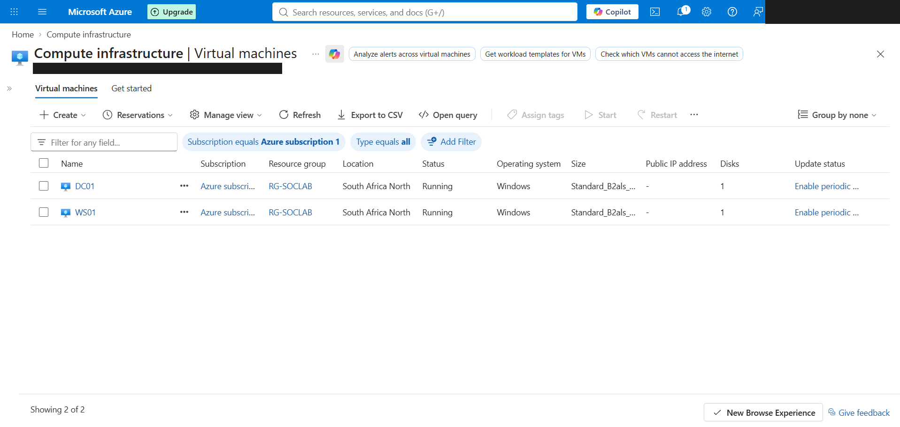
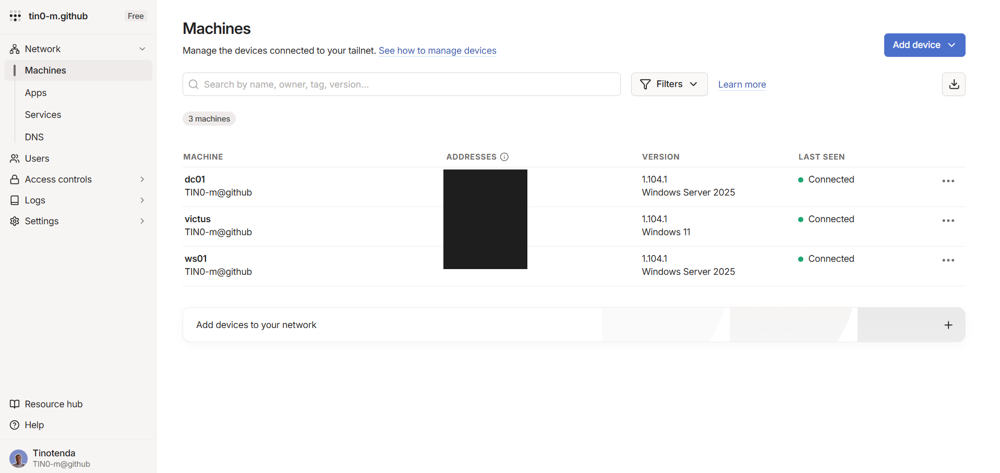

# Evidence: the lab running

Proof that the build in [`build/`](../build/) actually ran. Query results were pulled from the Sentinel workspace (`law-soclab`) on 24 October 2026 with [`build/scripts/kql.sh`](../build/scripts/kql.sh); the logs cover the lab's first full day, 16 October 2026. Screenshots have personal details (email, directory name, IP addresses) blacked out.

## 1. Both machines reported to Sentinel

```kql
Heartbeat
| summarize FirstSeen = min(TimeGenerated), LastSeen = max(TimeGenerated), Heartbeats = count() by Computer
```

| Computer | First seen (UTC) | Last seen (UTC) | Heartbeats |
|---|---|---|---|
| DC01.soclab.internal | 2026-10-16 08:38 | 2026-10-16 21:00 | 743 |
| WS01.soclab.internal | 2026-10-16 08:40 | 2026-10-16 21:01 | 741 |

The machines shut down automatically at 23:00 SAST (21:00 UTC), which is where the heartbeats stop.

## 2. Windows security events arrived from both machines

```kql
SecurityEvent
| summarize Events = count(), DistinctEventIDs = dcount(EventID) by Computer
```

| Computer | Events | Different event IDs |
|---|---|---|
| DC01.soclab.internal | 14,201 | 27 |
| WS01.soclab.internal | 4,995 | 36 |

Most common events, showing the audit policy from the logging GPO at work (logons, process creation with command lines, privileged operations, directory access):

| Event ID | Meaning | Events |
|---|---|---|
| 4624 | An account was successfully logged on | 3,098 |
| 4627 | Group membership information | 3,098 |
| 4688 | A new process has been created | 2,856 |
| 4634 | An account was logged off | 2,800 |
| 4672 | Special privileges assigned to new logon | 2,664 |
| 4674 | An operation was attempted on a privileged object | 1,205 |
| 4662 | An operation was performed on an object (directory access) | 1,115 |
| 4673 | A privileged service was called | 672 |
| 5140 | A network share object was accessed | 419 |
| 4702 | A scheduled task was updated | 359 |

## 3. Sysmon is collecting detailed activity

```kql
Event
| where Source == "Microsoft-Windows-Sysmon"
| summarize Events = count() by Computer, EventID
```

| Sysmon event | What it records | DC01 | WS01 |
|---|---|---|---|
| 1 | Process created (with hashes and parent process) | 308 | 495 |
| 3 | Network connection | 161 | 194 |
| 7 | Image (DLL) loaded | 856 | 1,237 |
| 10 | One process opening another (credential theft shows up here) | 306 | 522 |
| 11 | File created | 2,623 | 5,177 |
| 12 and 13 | Registry key and value changes | 4,086 | 4,606 |
| 22 | DNS query | 150 | 279 |

## 4. The detection rule is live in Sentinel

The rule from [`detections/privileged-group-change/`](../detections/privileged-group-change/), as deployed:

| Setting | Value |
|---|---|
| Name | Member added to a privileged AD group |
| Enabled | Yes |
| Severity | High |
| Runs every | 5 minutes, looking back 10 minutes |
| Creates an incident | Yes |
| MITRE ATT&CK | Persistence, Privilege Escalation · T1098 Account Manipulation |

No privileged group change has happened in the lab yet, so the rule has not fired. Testing it with a simulated attacker is the first exercise.

## 5. Locked down: no public IPs, no inbound internet

| Machine | Private IP | Public IPs |
|---|---|---|
| DC01 | 10.10.1.4 | 0 |
| WS01 | 10.10.1.5 | 0 |

Network security group `nsg-servers`: `Deny-Internet-Inbound`, priority 4000, deny all inbound traffic from the internet. Defender for Servers is on **Plan 2**.



Admin access is only through Tailscale: the analyst laptop and the two servers, nothing else.


